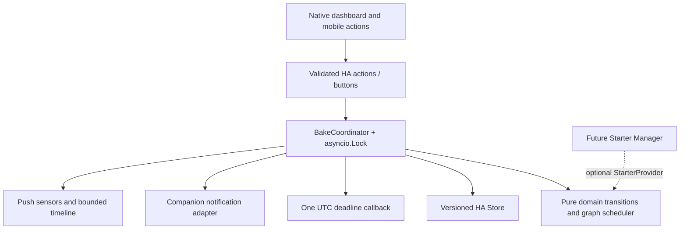

# Architecture and scheduling contract

`models.py`, `recipe_catalog.py`, `scheduler.py`, `serialization.py` and `starter.py`
are pure Python. Importing the domain does not require Home Assistant or any third
party dependency. The catalog reads only bundled JSON; HA runs that IO in an
executor. Frozen recipe definitions are embedded in every bake, so upgrading the
bundled recipe never rewrites an existing bake's instructions or original plan.

## Translations

`i18n.py` is a pure Python presentation adapter. It loads bundled UTF-8 JSON once,
in an HA executor during setup, and centralizes language normalization, lookup,
placeholder validation, and per-key English fallback. No translation lookup runs
inside the scheduler. Unknown recipes retain their snapshot text as a final
fallback. Identifiers, enums, dependencies, UTC times, and event names stay stable.

There are two complementary asset types, with no copied runtime dictionaries:

- `translations/en.json` and `translations/pl.json` use the official HA schema for
  flows, selectors, entity names/states/attributes, actions, and exceptions.
  `strings.json` mirrors the English source for maintenance; this custom integration
  ships resolved translation files, without core-only translation references.
- `localization/en.json` and `localization/pl.json` contain recipe presentation,
  dashboard text, reminder templates, Live Activity text, and diagnostic wrappers.
  They are separate because arbitrary recipe/frontend sections are outside the
  native translation schema. Runtime lookup reuses native states and exception
  messages rather than duplicating them here.

Bundled recipe display fields contain stable keys such as
`content.recipes.justyna_basic_wheat_sourdough.v1.steps.feed_starter.title`.
The presentation adapter also derives these keys from the recipe ID/version and
step ID for legacy English snapshots. Existing stored snapshots are never rewritten
to change their language. Preserve old versioned translations when changing a
recipe's method; introduce a new recipe version for changes to instructions or
timing. Ordinary spelling/translation corrections can update existing assets.
Recipe descriptions are presentation-only. User-provided IDs, references and notes
are displayed verbatim. Third-party transport error details are retained verbatim
inside translated diagnostic messages.

`language` is an additive config/options preference: `auto` (default), `en`, or
`pl`. Automatic mode reads `hass.config.language`; regional variants normalize to
their base language and unsupported languages use English. System configuration
events republish attributes and synchronize Live Activities without mutating the
bake. Options changes use the existing save/reload lifecycle. Native HA translation
keys let HA localize frontend controls independently. Stable entity object ID
suggestions preserve the original IDs even on first setup in Polish; existing
registry customizations continue to take precedence.

Static Lovelace Jinja has no frontend profile language context. The built-in
dashboard uses a localized `ui` attribute on the status sensor for headings and
copy, native names for buttons, and additive `state_label` timeline fields. Raw
status/timeline enums remain unchanged for automations. Markdown, recipe text, and
push content follow the backend preference; HA-owned dialogs and controls use HA's
frontend localization. No custom card or external translation fetch is required.

To add a language:

1. Copy both English JSON files to the new base language code in `translations/`
   and `localization/`. Translate every leaf, keeping keys and `{placeholders}`
   unchanged. Use UTF-8. Do not put runtime sections in the native file.
2. Add the code to the language selector in `config_flow.py`, and add its localized
   option label to each native translation file (and the English `strings.json`).
   Automatic mode discovers shipped native language files without a Python
   dictionary of supported locales.
3. Keep recipe IDs, versions, step IDs, ingredient indices, and service identifiers
   unchanged. Translate terminology, readiness conditions, and all safety warnings.
   Keep English complete and retain translations for every persisted recipe version.
4. Extend `tests/test_i18n.py` to compare the new locale's key sets and placeholders
   with English, exercise its recipes/notifications, and render dashboard templates.
   Run `python scripts/check.py` in the documented test environment.
5. Ship both files inside the integration directory. HACS distributes that directory
   recursively; there is no external locale package or build step. Restart HA and
   refresh frontend caches when installing edited assets.

Domain failures carry translation keys and parameters. The HA boundary adds
`translation_domain`, `translation_key`, and `translation_placeholders` to action
errors so the frontend can translate them. English `str(error)` remains readable
for logs and existing Python callers. Nested domain errors can be translated by
the backend presentation adapter. Missing or mismatched translated placeholders
fall back to English, and missing unknown-recipe keys fall back to snapshot text.

The coordinator deep-copies the current bake, applies a transition, persists the
candidate atomically, then publishes it. A failed write leaves the published bake
unchanged. Timer write failures retry after a minute. Service errors are returned
to the caller for explicit retry. All changes share one async lock, including
notification actions. Completed and canceled summaries are archived once; the
last 50 summaries and latest full bake are retained. There is one active bake.

## Time and dependency semantics

- All elapsed-time calculations and stored timestamps use aware UTC. HA dashboard
  templates convert to the configured HA timezone, including DST and midnight.
  Inputs without an offset are rejected, including ambiguous local times.
- `planned_at` is the immutable recipe reference offset. `due_at` is the current
  prediction from actual completions where known, otherwise estimated deadlines.
  `completed_at` is user-confirmed actual time. `snoozed_until` affects delivery only.
- `after_start` anchors to bake start. `after_completion` uses actual anchor
  completion and gates execution on it. `parallel_anchor` shares an actual anchor
  without chaining sibling completions. Explicit prerequisites add manual gates.
  `absolute` allows a validated UTC instant. Multiple anchors use their maximum.
- `adjust_step` requests an **earliest deadline**. It cannot bypass prerequisites
  or shorten a fixed process interval; the original plan remains unchanged. To
  advance a biological estimate, explicitly confirm its readiness checkpoint.
- Starting/completing a milestone records a human event, such as loading the loaf
  or placing dough in the fridge. Timed stages become actionable at their target;
  they never complete themselves. Starter, bulk, dough, oven and cooling readiness
  always require a person. Readiness estimates may be confirmed early through the
  canonical `complete_step` action when prerequisites are met.
- Both folds anchor to actual `bulk_start` (+30/+60), not to the previous fold.
  Preheat runs during cold proof, while baking waits for oven and dough gates.
- Covered baking is 20 minutes at 250 °C. Uncovered baking targets 20 minutes at
  230 °C and accepts manual removal after its minimum 15 minutes. Cooling adds a
  final manual checkpoint with a two-hour estimate. The 12 reference milestones
  are retained; `cooling_start` is an optional, silent technique substep.
- All MVP timers are wall-clock timers. Pause stops reminders and invalidates
  notification buttons; fermentation, cold proof and oven time keep passing.
  Resume reconciles real elapsed time and summarizes outstanding estimates.

Each mutation replaces the previous timer. Queued old callbacks have a generation
guard. Shutdown invalidates callbacks and listeners immediately and waits for an
in-flight write/delivery to finish. Entity listeners unsubscribe on removal.
There are no polling or countdown loops. Timeline data is bounded at 24 rows (the
bundled recipe has 21); arbitrary histories are never sent as state attributes.

## Notifications and recovery

The user selects an existing `notify.mobile_app_*` action. No phone is required.
Each notification supplies a dashboard link and random 192-bit Done/Snooze
capabilities. Persisted mappings bind each token to bake ID, step ID, action and
notification generation. Lifecycle, prerequisites and generation are rechecked
under the lock. Completing, adjusting, snoozing, pausing, canceling or replacing a
bake invalidates affected old capabilities. Raw step IDs are never accepted from
mobile events. Capabilities are stored in a private HA Store and never in sensors.

Delivery is reserved in storage **before** contacting the phone, preventing replay
storms after a crash. Push transport has no atomic transaction with HA Store, so
exactly-once physical delivery cannot be guaranteed: a crash between reservation
and send can postpone a reminder until the next repeat interval. Failed sends
retry at the configured interval; the engine stays operational and reports the
error in status attributes/logs. Restart/resume sends at most one consolidated
catch-up payload; its buttons apply only to the first named task. Reminders use a
single bake-specific notification tag, replacing the visible notice. Repeat
interval defaults to 30 minutes; Snooze explicitly overrides it for 10 minutes.

Store schema v2 adds `starter_id` and workflow defaults to v1 records. Missing
starter fields deserialize as `None`/`feed`. Unknown major versions and invalid
domain payloads fail setup without overwriting the data. HA owns JSON file IO,
atomic replacement and malformed JSON recovery. See troubleshooting before
restoring backups or downgrading.

Optional Live Activities use `live_activities.py` alongside the reminder adapter.
The same coordinator lock serializes both channels; domain changes commit before
Live Activity side effects. The manager sends documented Companion payloads under
a separate tag. It compares snapshots to avoid reminder-only updates and uses an
absolute device countdown instead of polling. Its renewal and retry deadlines
join the coordinator's existing single UTC callback, including while paused or
after terminal-state cleanup fails.

Store v2 has an additive `live_activities` list, defaulting to empty for old
records. Each record holds a bake UUID, target service and UTC start reservation.
Start reservations persist before pushes; clear reservations disappear only after
successful clear delivery. Records live outside the latest bake snapshot, so old
cleanup is retained when another bake starts or the target changes. A removed old
target does not block delivery to a new target. Restart reconciles active, paused,
terminal and disabled configurations and preserves activity age. Renewal after
7h55m clears/starts the same tag to accommodate Apple's eight-hour lifetime;
there is no device acknowledgement, so physical continuity remains best effort.
Transport/metadata errors have their own `live_activity_error` status attribute
and 15-minute retry deadline. Shutdown prevents new sends and preserves recovery
metadata. See [configuration, payload and iOS layout limits](../README.md#ios-live-activities-optional).

## Adding Starter Manager later

`StarterProvider.async_get_starter(starter_id)` is the only prospective provider
boundary. It returns `StarterInfo(id, name, last_fed_at, readiness, metadata)` or
`None`; it contains no entity IDs, services, HA imports or storage assumptions.
`StarterReadiness` has unknown, not-ready and ready states. A future HA adapter can
provide this protocol when Starter Manager is present and fetch facts outside the
bake mutation lock. It can present those facts to the user, then use the existing
explicit readiness confirmation transition. Provider data must never silently
complete a readiness checkpoint.

`BakeRun.starter_id` is an optional opaque reference, not a foreign key into a
future database. Deleted/unavailable providers must not invalidate bake snapshots.
Unlinked bakes continue normally; old records need no redesign. The current MVP
does not call a provider, store starter facts, feed history, monitor starters or
create Starter Manager entities, services or UI.

Workflow `feed` includes feeding and its later manual readiness checkpoint.
Workflow `prepared` marks feeding intentionally skipped with a timestamp and note,
starts autolyse immediately, and retains readiness confirmation. Passing
`starter_ready: true` is permitted only with `prepared` and records an explicit
user confirmation. Original reference offsets remain available for comparison.

## API references checked

The redesigned dashboard uses a dependency-free ES module in `frontend/`, registered
by `frontend.py` through HA's async static-path API and extra-module loader. HTTP
and frontend are optional `after_dependencies`; headless installs keep working.
The HACS integration package includes all three JS files. There is no build step,
network fetch of libraries, mandatory theme, or separate HACS frontend package.
The original native dashboard is retained as a fallback.

`bread-assistant-card.js` implements HA's custom-element card contract (`setConfig`,
`hass`, `getCardSize`, `getGridOptions`). `styles.js` centralizes scoped theme tokens
and responsive components; `strings.js` owns English/Polish card chrome. Recipe,
safety and diagnostic content comes from existing localized sensor attributes.
Each bundled recipe step now has a complete source `instructions` string plus
separate `summary` and `confirmation_hint` strings. The current-step sensor exposes
these as `instructions`, `instructions_summary`, `confirmation_hint`, and a
recipe-level `instructions_attribution`. These additive presentation attributes
are resolved through versioned localization keys, including for legacy snapshots;
there is no model, snapshot, migration or scheduler change. Unknown/custom recipes
retain their own instructions and fall back to the previous summary rendering.
Only the current step's text is published; timeline attributes remain bounded and
do not contain all source passages. The native dashboard also shows source text
and confirmation guidance separately.
Content follows the backend language preference, including automatic HA system
language selection. Contributors adding a language should translate both the
backend bundles and `frontend/strings.js`; browser checks enforce matching keys.

The card subscribes through HA's normal `hass` setter and renders only for relevant
sensor/connection changes. A connected-only interval changes countdown text and
time-dependent presentation, without polling the server or writing entities. It
preserves expanded details and keyboard focus across updates, clamps unavailable
progress, disables unavailable actions, and respects reduced-motion preferences.
Dates use HA's system timezone and the integration's time-format preference.

Actions call the existing canonical services with the displayed bake/step IDs.
Failures are shown inline; a retry retains those IDs rather than retargeting another
step. A busy guard prevents overlapping submissions. Cancel asks for confirmation.
Snoozing changes reminder delivery only, pause does not freeze process time, and
no readiness gate is auto-confirmed. No domain or scheduling logic changes.
Dynamic text is HTML-escaped and source URLs permit only HTTP(S). All CSS is in a
shadow root. Local browser fixtures exercise the real sensor presentations;
see [UI validation](ui-validation.md).

Implementation was checked against installed HA 2026.10.4 source and real fixtures:
[actions](https://developers.home-assistant.io/docs/dev_101_services/),
[config entries](https://developers.home-assistant.io/docs/config_entries_index/),
[options flows](https://developers.home-assistant.io/docs/config_entries_options_flow_handler/),
[sensor entities](https://developers.home-assistant.io/docs/core/entity/sensor/),
[Store source](https://github.com/home-assistant/core/blob/2026.10.4/homeassistant/helpers/storage.py),
[UTC timers](https://github.com/home-assistant/core/blob/2026.10.4/homeassistant/helpers/event.py),
and [Companion actions](https://companion.home-assistant.io/docs/notifications/actionable-notifications/).
